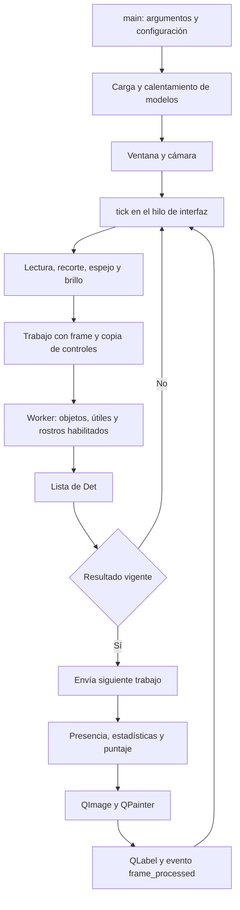
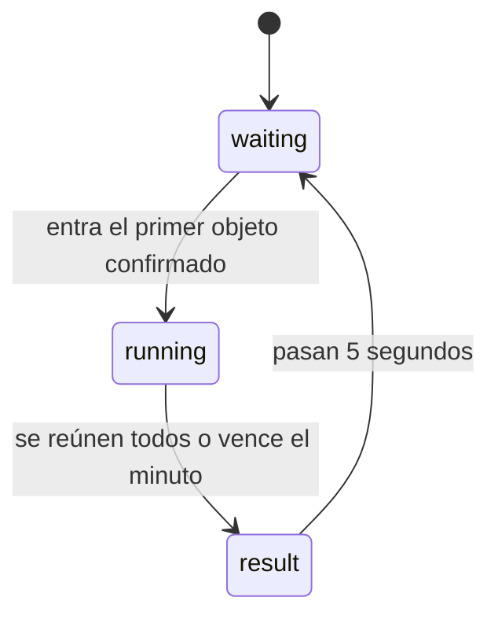

# VisionAI: guía para entender y defender el proyecto

Basada en el código de esta copia, revisado el **9 de noviembre de 2026**. Incluye el detector de útiles y el interruptor de rondas. Las referencias `archivo.py:línea` permiten localizar la implementación; pueden desplazarse si se edita el código.

**Cómo estudiarla:** primero comprende las secciones 1–6; después explica el recorrido de un frame con el código abierto; finalmente responde las preguntas sin mirar las respuestas. Para una preparación rápida, empieza por las secciones 1, 5, 10 y 13. Comprender una decisión significa poder explicar qué problema resuelve, dónde se implementa y qué pasaría al cambiarla.

## Síntesis del proyecto

VisionAI es una aplicación de escritorio en Python y PySide6 que usa la cámara para detectar objetos, personas y rostros en tiempo real. Combina modelos YOLO para objetos generales y útiles escolares con BlazeFace para rostros; ejecuta los modelos YOLO en CPU mediante OpenVINO y muestra cajas, etiquetas en español y confianza sobre el video.

Ofrece un modo General y otro Universitario, que asigna puntos por los objetos visibles o los acumula en rondas de 60 segundos. Las reglas temporales estabilizan el puntaje y la inferencia en un hilo separado mantiene la interfaz disponible. Incluye capturas, estadísticas, avisos de poca luz, herramientas de preparación y evaluación de datos y pruebas automatizadas. Su rendimiento y sus aciertos dependen del equipo, la iluminación y los objetos presentados.

## Índice

1. [Qué proyecto vas a defender realmente](#1-qué-proyecto-vas-a-defender-realmente)
2. [Mapa del código y responsabilidades](#2-mapa-del-código-y-responsabilidades)
3. [Recorrido completo: desde encender la app hasta ver una caja](#3-recorrido-completo-desde-encender-la-app-hasta-ver-una-caja)
4. [La parte de inteligencia artificial](#4-la-parte-de-inteligencia-artificial)
5. [Puntaje, presencia y rondas](#5-puntaje-presencia-y-rondas)
6. [Concurrencia y decisiones de interfaz](#6-concurrencia-y-decisiones-de-interfaz)
7. [Entrenamiento y preparación de datos](#7-entrenamiento-y-preparación-de-datos)
8. [Evaluación y rendimiento: qué demuestran los números](#8-evaluación-y-rendimiento-qué-demuestran-los-números)
9. [Qué se comprobó en esta revisión](#9-qué-se-comprobó-en-esta-revisión)
10. [Preguntas de defensa, con respuestas](#10-preguntas-de-defensa-con-respuestas)
11. [Ejercicios de ejecución mental](#11-ejercicios-de-ejecución-mental)
12. [Cómo demostrarlo y diagnosticar fallos](#12-cómo-demostrarlo-y-diagnosticar-fallos)
13. [Hoja de repaso antes de entrar](#13-hoja-de-repaso-antes-de-entrar)

## 1. Qué proyecto vas a defender realmente

### Explicación de 45 segundos

> VisionAI es una aplicación de escritorio en Python que captura imágenes de una cámara y combina un detector de objetos generales, otro entrenado para útiles y uno especializado en rostros. Convierte sus resultados a un formato común y dibuja cajas, etiquetas en español y confianza. En el modo universitario aplica reglas de presencia temporal para evitar puntajes inestables. Permite puntuar los objetos visibles o acumularlos durante una ronda. La inferencia se ejecuta en un hilo separado de la interfaz y se descartan los resultados que pertenecen a una configuración anterior.

La idea central es separar **percepción**, **reglas del producto** e **interfaz**. Una red predice «hay una laptop en esta caja»; otra parte del programa decide «esa clase vale 25 puntos»; otra lo representa visualmente.

### Fotografía de la versión actual

| Aspecto | Comportamiento del código actual |
|---|---|
| Aplicación | Escritorio, Python y PySide6. El flujo principal no necesita un servidor. |
| Objetos generales | Perfil `detail`: YOLOv8n a 480; `fast`: YOLOv8n a 320; `accurate`: YOLO26s a 640. |
| Útiles | YOLOv8n ajustado para `pencil`, `notebook` y `pen`, entrada 640. Se carga automáticamente si existe su carpeta. |
| Rostros | MediaPipe Tasks con BlazeFace, separado de la detección de personas. |
| Ejecución de los YOLO | Modelos exportados a OpenVINO; configuración documentada FP32. |
| Perfil inicial en esta copia | `detail`, porque existe `models/stationery_openvino_model/`. |
| Modo inicial | General. |
| Universitario inicial | Puntaje en vivo al entrar; la ronda se activa por casilla o con `--uni-round`. |
| Puntaje en vivo | Cinco tipos, hasta 75 puntos si están disponibles. |
| Ronda | Cuatro tipos históricos, hasta 60 puntos si están disponibles. |
| Insignia | Puntaje mayor o igual a 50. |

**Ojo con estudiar documentos históricos como si fueran la versión actual.** En `PLAN.md`, `CLAUDE.md` y partes de `GUION_DEMO.md` aparecen decisiones anteriores: sin entrenamiento, solo rondas o `accurate` predeterminado en Windows. El código actual incorpora un modelo ajustado y puntaje en vivo. `PROGRESO.md` registra esa evolución al final; `DATASET_RECONOCIMIENTO.md` comienza con el modelo de útiles vigente y luego conserva experimentos anteriores.

La condición exacta del perfil inicial está en `config.py`: Windows usa `accurate` **solo si falta la carpeta predeterminada de útiles**; en los demás casos usa `detail`. Pasar `--quality` permite elegir explícitamente.

## 2. Mapa del código y responsabilidades

| Archivo | Qué debes entender | Por dónde empezar |
|---|---|---|
| `config.py` | Rutas, perfiles, etiquetas, puntos y constantes temporales. | `MODEL_PROFILES`, `LABELS_ES`, `UNI_ITEMS`, `UNI_LIVE_ITEMS`. |
| `detector.py` | Carga los modelos, solicita clases, fusiona resultados y devuelve detecciones. | `Det`, `Detector.detect`, `_predict_objects`, `_detect_faces`. |
| `scoring.py` | Decide presencia, puntaje y transiciones de ronda. No procesa imágenes. | `PresenceTracker`, `UniScorer.update`, `advance`, `_snapshot`. |
| `app.py` | Cámara, controles, hilo de inferencia, dibujo, estadísticas y capturas. | `main`, `tick`, `on_inference_finished`, `update_panel`. |
| `tools/merge_stationery_color.py` | Unifica datasets de útiles y sus identificadores. | `ALIASES`, `merge`, `seen`. |
| `tools/prepare_stationery.py` | Convierte cajas o polígonos a cajas YOLO; preparación del experimento anterior. | `detection_box`. |
| `tools/evaluate_detection.py` | Evalúa predicciones COCO con cajas de referencia. | `match_image`, `ratios`, `evaluate_records`. |
| `tools/compare_models.py` | Captura muestras sin overlays y compara perfiles sobre los mismos frames. | `build_sample_window`, `main`. |
| `tools/profile_app.py` | Mide captura, inferencia y presentación. | `measured`, conexión a `frame_processed`. |
| `tools/verify_live.py` | Registra sesiones, eventos, rendimiento y memoria. | `Verification`. |
| `tests/` | Comprueba reglas, interfaz simulada, captura de muestras y evaluación. | Leer los escenarios, no solo el resultado «OK». |
| `models/` | Pesos originales y exportaciones usadas al ejecutar. | `metadata.yaml` de cada exportación. |

`requirements.txt` declara cuatro dependencias de alto nivel: Ultralytics, OpenVINO, MediaPipe y PySide6. Los instaladores y locks concretan el entorno. OpenCV, NumPy y PyTorch también participan, aunque no figuren como cuatro líneas adicionales en ese archivo.

### El contrato que conecta todo: `Det`

En `detector.py:20` cada detección se representa así:

```python
Det(
    key="laptop",              # Identidad lógica para filtrar y puntuar.
    label="Laptop",            # Texto de presentación.
    conf=0.87,                 # Puntaje del detector, entre 0 y 1.
    box=(80, 90, 280, 280),     # x1, y1, x2, y2, en píxeles del frame procesado.
    group="objetos",           # Grupo de controles y color.
)
```

**Por qué no usar solo la etiqueta:** traducir «Laptop» no debería romper el puntaje. La lógica utiliza `key`; el usuario ve `label`. Los identificadores numéricos son propios de cada modelo y se traducen usando `model.names`.

`scoring.py` recibe conjuntos como `{"laptop", "book"}`. No conoce cajas, píxeles ni porcentajes de confianza. Esto permite comprobar el puntaje sin cargar modelos ni abrir una cámara.

## 3. Recorrido completo: desde encender la app hasta ver una caja



### Paso 1: argumentos y modelos

`app.py:1024`, `main()`:

1. Lee argumentos como `--camera`, `--quality`, `--mode`, `--uni-round` y `--resolution`.
2. Ajusta `config.MODEL_PATH`, `config.IMGSZ` y, si corresponde, la resolución solicitada.
3. Crea `QApplication` y aplica el tema.
4. Selecciona la carpeta de útiles: una explícita o la predeterminada si existe.
5. Construye `Detector` y después `MainWindow`.
6. Muestra la ventana y entra al bucle de eventos Qt mediante `app.exec()`.

La carga ocurre antes de mostrar la ventana. Por eso un arranque que tarda varios segundos puede ser compilación/calentamiento de los modelos, no una cámara lenta.

`Detector.__init__` predice sobre un frame negro antes de consultar `model.names`. Según la decisión documentada y el comentario del código, evita que consultar los nombres provoque una compilación temporal adicional. También prepara el primer uso real.

### Paso 2: cámara

`open_camera`, en `app.py:53`, usa DirectShow y luego intenta MSMF en Windows; en Linux usa V4L2. Solicita MJPG, ancho, alto y un buffer de un frame. Solicitar una propiedad **no prueba** que el driver la respete.

Sin `--camera`, se prueban los índices 0–5 y se prefiere el índice configurado si aparece entre las cámaras válidas. Con `--camera N`, se intenta abrir directamente ese índice, sin hacer primero el sondeo completo.

El selector vuelve a buscar cámaras al desplegarse. Omite reabrir la que ya está en uso y conserva su entrada con la resolución informada por el dispositivo.

### Paso 3: preparar un trabajo

`tick`, en `app.py:534`, retorna inmediatamente si se está cerrando, hubo un error pendiente, falta cámara o ya hay una inferencia en curso.

Si puede trabajar:

1. Lee un frame BGR con `cap.read()`.
2. Recorta las primeras cuatro filas en Linux; en Windows no recorta. Es una adaptación histórica a una cámara USB, aplicada actualmente por plataforma.
3. Hace espejo horizontal antes de detectar. Si se desactiva el espejo, copia el frame para que el worker tenga un buffer independiente.
4. Estima el brillo en una miniatura gris de 64×36.
5. Copia los controles relevantes dentro de un diccionario `job`.
6. Guarda el trabajo en `_inflight` y emite `inference_requested`.

El trabajo contiene `generation`, `frame`, `conf`, `groups`, `only_keys`, `mode` y `brightness`. `groups` y `only_keys` se convierten a `frozenset` para fijar la selección de ese trabajo.

### Paso 4: inferencia

`InferenceWorker.run`, en `app.py:178`, llama a `Detector.detect` desde el `QThread`. Los detectores habilitados se ejecutan **secuencialmente dentro de esa llamada**. Tener un hilo para inferencia no significa que los tres modelos se ejecuten simultáneamente.

Si hay una excepción durante la detección, el worker la convierte en un mensaje y lo devuelve mediante una señal. No intenta modificar widgets.

### Paso 5: recibir o descartar

`on_inference_finished`, en `app.py:561`:

1. Comprueba que el trabajo devuelto sea exactamente el que estaba pendiente. Una entrega duplicada se ignora.
2. Libera `_inflight`.
3. Descarta el resultado si se está cerrando, cambió la generación o ya no hay cámara.
4. Si el trabajo vigente falló, pausa el bucle y muestra el error.
5. Si sigue habilitada la captura, envía el siguiente trabajo **antes de dibujar este resultado**.
6. Actualiza apariciones, brillo y puntaje usando `time.monotonic()` del hilo de interfaz.
7. Dibuja y presenta la imagen.
8. Actualiza los tiempos de FPS y emite `frame_processed`.

No se dibujan las cajas viejas sobre el frame del trabajo siguiente. Cada resultado conserva su propio `job["frame"]`.

### Paso 6: dibujo y captura

`to_qimage`, en `app.py:95`, interpreta la entrada como `BGR888` y la convierte a `RGB32`. La conversión crea memoria propia para la imagen y permite dibujar con Qt. «32» describe el formato de píxel de Qt; **no significa que la imagen tenga canales flotantes de 32 bits**.

`QPainter` dibuja sobre la imagen a resolución del frame. Solo después se escala al espacio del `QLabel` manteniendo la proporción. Así las cajas y los píxeles cambian de tamaño juntos.

`capture()` guarda `last_image`: video con overlays a resolución completa del frame procesado. No guarda los botones ni el panel. El destello se agrega al pixmap mostrado, después de guardar, por lo que no contamina el PNG.

`--autoshot` es distinto: utiliza `self.grab()` para guardar **la ventana completa**, imprime una medición y sale.

## 4. La parte de inteligencia artificial

### Qué hacen los tres modelos

**YOLO general:** sus pesos COCO tienen 80 categorías. VisionAI permite 13 de ellas: persona, mochila, bolso, celular, laptop, libro, mesa, silla, botella, taza, teclado, mouse y tijeras.

**YOLO de útiles:** parte de YOLOv8n y se ajustó a tres clases: lápiz, cuaderno y lapicero. Complementa al general sin sustituirlo.

**BlazeFace:** devuelve cajas de rostros. Detectar una persona no localiza automáticamente su rostro. El sistema tampoco identifica a quién pertenece una cara.

Con los modelos incluidos, el conjunto habilitable es de **16 clases de objetos/personas y una de rostro**. Los grupos del control son tres; los grupos no son el número de clases.

### Inferencia no es entrenamiento

Al abrir `app.py`, los pesos se usan para predecir. No se entrena con el video ni se actualizan los pesos por mostrar objetos. El puntaje se calcula con reglas escritas a mano; no es una salida aprendida por YOLO.

En esta versión sí hay entrenamiento previo del modelo de útiles. La explicación correcta distingue:

- Modelos generales COCO: preentrenados; elegir un perfil o exportarlo no es reentrenarlo.
- Modelo de útiles: ajuste supervisado a partir de pesos preentrenados.
- Aplicación en vivo: inferencia y reglas temporales.

### Cómo explicar YOLOv8n sin recitar nombres

1. **Preprocesamiento:** Ultralytics recibe el frame BGR, adapta el tamaño manteniendo proporciones mediante letterbox, organiza el tensor en lote/canales/alto/ancho, convierte a RGB y normaliza valores.
2. **Extracción:** convoluciones y bloques de la red extraen patrones de distintas escalas.
3. **Combinación de escalas:** mezcla información espacial detallada y contexto para objetos de distintos tamaños.
4. **Predicción:** la cabeza produce ubicaciones y puntajes de clase.
5. **Selección:** filtra por confianza y aplica el postproceso correspondiente; para YOLOv8 hay supresión de cajas redundantes mediante NMS.
6. **Retorno a coordenadas del frame:** la biblioteca devuelve `boxes.xyxy`; el proyecto no dibuja directamente sobre las coordenadas de la entrada cuadrada.

La arquitectura YOLOv8 instalada utiliza bloques `C2f`, `SPPF` y salidas a strides 8, 16 y 32. En una entrada cuadrada 480, las posiciones espaciales son:

```text
60×60 + 30×30 + 15×15 = 4,725
```

Para 320 son 2,100; para 640, 8,400. **Son posiciones candidatas, no objetos detectados.** No atribuyas automáticamente esos detalles a cualquier versión de YOLO: el perfil `accurate` usa otra arquitectura. La explicación de su ruta concreta debe respetar su exportación y metadatos; esta guía desarrolla YOLOv8 porque es el predeterminado y la base del detector de útiles.

El preprocesamiento y el postproceso de la red están delegados a Ultralytics, no implementados desde cero en `detector.py`. En el entorno local se pueden seguir en `ultralytics/engine/predictor.py` y `ultralytics/models/yolo/detect/predict.py`.

### Resolución de cámara frente a entrada del modelo

Una cámara puede entregar 1280×720 y el detector trabajar a 480×480. La biblioteca reduce la imagen y agrega relleno; después devuelve cajas a la escala del frame original procesado.

Ejemplo geométrico con letterbox centrado: 1280×720 pasa a 480×270 y necesita 210 píxeles de relleno vertical en total para completar 480×480. El contenido no se debería estirar a un cuadrado.

Una captura de más resolución puede conservar detalle antes de reducir, pero cuesta más transferirla y dibujarla. Un modelo con mayor entrada puede representar mejor objetos pequeños, pero cuesta más inferencia. **Ninguna de esas decisiones garantiza más aciertos en toda clase y escena.**

### Confianza y filtros

El slider inicial es 0.35. Ese valor filtra candidatos; no cambia los pesos ni entrena el modelo.

BlazeFace tiene además un mínimo propio de 0.5, configurado al crearlo. El umbral efectivo de rostro es:

```text
max(0.5, confianza del slider)
```

Una confianza de 87 % representa el puntaje asignado a esa predicción. No prueba una exactitud general del 87 % ni una probabilidad calibrada del 87 % en las escenas de la demo.

### Fusión entre libro y cuaderno

Si los dos YOLO detectan el mismo cuaderno como `book` y `notebook`, `Detector.detect`, en `detector.py:115`, elimina la detección `book` cuando se solapa mucho con una de `notebook`.

```text
IoU = área de intersección / área de unión
Se suprime book si IoU ≥ 0.7 con notebook.
```

Esto prioriza una clase especializada sobre una general. No promedia cajas, no selecciona por mayor confianza entre los dos modelos y no convierte una laptop en cuaderno. Tampoco es una fusión general de todas las clases.

## 5. Puntaje, presencia y rondas

### Dos tablas distintas

| Objeto / clave | En vivo (`UNI_LIVE_ITEMS`) | Ronda (`UNI_ITEMS`) |
|---|---:|---:|
| Mochila / `backpack` | 10 | 10 |
| Cuaderno / `notebook` | 15 | No participa |
| Libro / `book` | 20 | 20 |
| Laptop / `laptop` | 25 | 25 |
| Lapicero / `pen` | 5 | No participa |
| Celular / `cell phone` | No participa | 5 |
| Lápiz / `pencil` | No participa | No participa |
| Máximo con todas las clases disponibles | **75** | **60** |

**Detectable no significa puntuable.** El lápiz aparece en General, pero no suma. El celular suma en la ronda histórica y no en vivo.

`UniScorer` intersecta la tabla elegida con `available_keys`. Su máximo depende de las clases declaradas por los modelos cargados, no de lo que la cámara vea ese instante. La insignia mantiene el umbral absoluto de 50; no se convierte a un porcentaje del máximo.

### Presencia temporal, explicada exactamente

`PresenceTracker`, en `scoring.py:7`, guarda por clase:

- `first`: inicio de la racha.
- `last`: última observación positiva.
- `_prev_present`: clases presentes en la actualización anterior.

Una clase cuenta como presente si:

```python
now - last <= 0.7 and last - first >= 0.3
```

Cuando vuelve a observarse tras más de 0.7 s, comienza una racha nueva.

La condición exige **observaciones positivas separadas al menos 0.3 s dentro de una racha que no caduque**. Una sola observación seguida de esperar 0.3 s no basta, porque `last - first` continúa valiendo cero. Tampoco se exige detección positiva en todos los frames: tolera huecos de hasta 0.7 s.

`entered = present - previous_present` informa transiciones de ausente a presente. Un conjunto elimina multiplicidad: dos libros generan la misma clave `book` y valen 20, no 40.

La caja visible representa detecciones del frame actual; la presencia temporal puede mantenerse 0.7 s después de la última detección. Por eso puede desaparecer una caja y seguir el puntaje durante un momento.

### Puntaje en vivo

En `UniScorer.update`, si `live=True`, se construye el estado a partir de las presencias actuales. Cuando una clase caduca, deja de sumar. El estado reutiliza nombres como `collected`, pero en este modo representa ítems presentes, no una colección permanente.

No hay ronda activa ni límite de un minuto en este modo. Internamente `phase` permanece en `waiting`; la interfaz oculta el reloj de ronda. Sería incorrecto interpretar ese `waiting` como «no está sumando».

### Ronda acumulativa



En `running`, `new = present - collected`; las claves nuevas se agregan mediante unión de conjuntos. Retirar y reintroducir el mismo tipo no vuelve a sumar en esa ronda.

El reloj arranca con la primera **presencia confirmada**, no con el primer frame que contiene el objeto. La insignia aparece desde 50, pero la ronda solo termina por completar todos los ítems disponibles o por tiempo. Con máximo 60, llegar a 50 puede dejarla en marcha.

Al terminar por tiempo, `_finish` registra como fin el plazo real, no el instante tardío en que vuelve un frame. Así una pausa de captura no regala tiempo extra ni extiende indebidamente los cinco segundos del resultado.

El tracker se conserva al terminar una ronda. Si los mismos objetos siguen presentes, no generan otra entrada y no arrancan rondas automáticamente. Si entra un tipo que estaba ausente, ese evento puede iniciar otra ronda; los demás tipos que sigan presentes también pueden quedar recogidos al comenzar.

### Qué significa el nivel

El título se toma del ítem activo con más puntos; no se obtiene de una tabla de rangos de puntaje total.

Ejemplo: una laptop sola da 25 y el título «Listo para el aula», aunque todavía no haya insignia. La insignia depende separadamente de `score >= 50`.

### Avanzar el tiempo no es añadir evidencia

`update(keys, now)` incorpora observaciones. `advance(now)` actualiza plazos y consulta qué presencias siguen vigentes, pero no inventa nuevas detecciones ni actualiza `last`.

El panel llama a `advance` cada 250 ms. Si la cámara se pierde, el reloj de ronda sigue y el puntaje en vivo puede caducar. La imagen superpuesta depende de un resultado nuevo para redibujarse; el panel y la imagen congelada pueden mostrar momentáneamente estados de tiempos distintos.

### Cambiar controles y reiniciar

| Acción | Puntaje actual | Mejor puntaje y estadísticas | Elección en vivo/ronda |
|---|---|---|---|
| Entrar desde General a Universitario | Se reinicia | Se conservan | Se conserva |
| Activar/desactivar Ronda de 60 s | Se reinicia | Se conservan | Cambia |
| Pulsar Reiniciar | Se reinicia | Se ponen en cero | Se conserva |
| Cerrar y volver a abrir | Se inicia otra sesión | Se inicia otra sesión | Se toma el argumento de inicio |

No hay persistencia de estadísticas en base de datos. Los PNG guardados permanecen aunque el contador de capturas se reinicie.

## 6. Concurrencia y decisiones de interfaz

### Qué hace cada hilo

| Hilo de interfaz | Hilo de inferencia |
|---|---|
| Leer y liberar cámara | Ejecutar `Detector.detect` |
| Gestionar controles y temporizadores | Ejecutar los modelos habilitados |
| Calcular presencia y puntaje | Devolver detecciones o un error |
| Dibujar y actualizar widgets | No modifica widgets |

Las señales usan `QueuedConnection`; el slot del worker se ejecuta en su hilo y el receptor de la ventana en el principal. La cámara se mantiene en la interfaz, por lo que una lectura del driver que bloquee puede afectar su respuesta. Mover la inferencia no elimina todos los posibles bloqueos.

### Una inferencia en curso

Mientras `_inflight` no sea `None`, `tick()` no lee ni manda otro frame. Evita acumular trabajos que luego mostrarían resultados con retraso.

Al cambiar un control, `_generation` aumenta. El trabajo ya enviado conserva la generación anterior y se descarta al volver. **Invalidar no cancela la operación nativa en curso.** Tampoco libera anticipadamente `_inflight`: hacerlo permitiría encolar otra llamada mientras la anterior sigue ejecutándose.

El siguiente trabajo se envía antes de pintar el resultado aceptado. Esto permite solapar inferencia del siguiente frame con parte del trabajo gráfico actual. No garantiza que todas las etapas se solapen por completo ni que haya dos inferencias concurrentes.

### Temporizadores

- Video: temporizador preciso de 1 ms. Es una oportunidad de revisar si se puede trabajar, no una promesa de 1,000 FPS.
- Panel: 250 ms. Evita reconstruir sus textos en cada frame y mantiene el reloj sin inferencias nuevas.
- Reconexión: 2 s. Intenta recuperar la cámara elegida; si nunca hubo selección, busca una disponible.

### Detalles visuales que tienen una razón técnica

- `QPainter` permite dibujar textos en español con las fuentes de Qt, incluidos acentos y ñ.
- El tamaño de texto/cajas se escala con `alto_frame / 720`.
- Las etiquetas se ordenan por confianza; si dos píldoras chocan, las posteriores se desplazan hacia abajo. Esto no es NMS: solo acomoda textos.
- `QSizePolicy.Ignored` impide que el tamaño del pixmap haga crecer repetidamente el layout.
- La barra suaviza su valor con `disp += (score - disp) * 0.15`; el número de puntos representa el estado real. La barra puede ir detrás del número.
- El suavizado usa pasos por frame, por lo que a menos FPS tarda más tiempo real en alcanzar visualmente el mismo valor.

### Fallos y cierre

Tras 15 lecturas fallidas consecutivas, se muestra el estado sin cámara. No son 15 segundos. Una lectura válida reinicia el contador.

Un error vigente de inferencia pausa el bucle hasta que una acción invalida/reintenta la configuración. Un error de una generación antigua se descarta con el trabajo antiguo. La carga inicial de modelos sucede fuera de ese `try`: no hay que prometer que un modelo ausente o corrupto producirá el mismo mensaje recuperable.

`shutdown()` es idempotente: marca cierre, detiene temporizadores, libera la cámara, solicita el fin del hilo y espera a que termine. `requestInterruption()` no interrumpe por sí solo una inferencia nativa; si esta quedara colgada, `wait()` no tiene timeout en esta versión.

## 7. Entrenamiento y preparación de datos

### Qué se ajustó

Según `DATASET_RECONOCIMIENTO.md`, el detector vigente se ajustó desde `models/yolov8n.pt` con dos fuentes a color: School supplies v3 y detector_de_utiles v1. El documento identifica sus autores, enlaces y licencia CC BY 4.0.

| Partición | Imágenes | Cajas de lápiz | Cajas de cuaderno | Cajas de lapicero |
|---|---:|---:|---:|---:|
| Entrenamiento | 907 | 210 | 214 | 345 |
| Validación | 97 | 20 | 35 | 41 |
| Prueba | 40 | 7 | 9 | 10 |

Las columnas de objetos cuentan **cajas**, no imágenes de cada clase. Algunas imágenes pueden no tener ninguna clase objetivo y sirven como fondo.

La receta registrada usa entrada 640, 24 épocas, batch 8, `freeze=7`, AdamW, tasa inicial 0.001, semilla 42, `mosaic=0.15`, `close_mosaic=4` y `amp=False`. Estos parámetros pertenecen al entrenamiento; no describen la ejecución de la cámara.

Debes poder explicar estas decisiones, sin presentar su receta como una búsqueda exhaustiva del óptimo:

| Concepto | Qué significa aquí |
|---|---|
| Transferencia | Reutilizar representaciones aprendidas y adaptar el detector a útiles. |
| Época | Un recorrido del entrenamiento por el conjunto de entrenamiento. |
| Batch 8 | Entrenar con grupos de ocho imágenes por paso, sujeto al funcionamiento del entrenador. |
| `freeze=7` | Mantener congelados los primeros siete módulos/capas según la numeración del entrenador; no «el 7 %». |
| AdamW / `lr0` | Optimizador y magnitud inicial de los pasos de ajuste. |
| Mosaic | Aumento que combina imágenes; la receta lo desactiva en las últimas cuatro épocas. |
| `amp=False` | Desactiva entrenamiento automático de precisión mixta. No es el formato de píxel de Qt. |
| `best.pt` | Pesos seleccionados por el criterio de validación del entrenador; no asumir que son los de la última época. |
| Exportación OpenVINO | Preparar un modelo para inferencia; no añade ejemplos ni aprende nuevas clases. |

Los comandos de entrenamiento documentados usan `device=0` para GPU. La aplicación de escritorio usa modelos exportados en CPU. Entrenar y ejecutar no tienen que usar el mismo hardware.

### Cómo se unifican los datasets

`tools/merge_stationery_color.py` realiza decisiones concretas:

1. Lee los nombres de cada ZIP, en lugar de asumir que sus IDs coinciden.
2. Traduce alias: `cuaderno → notebook` y `lapicero → pen`.
3. Reasigna IDs al orden único `pencil=0`, `notebook=1`, `pen=2`.
4. Convierte cajas/polígonos con `detection_box`.
5. Conserva las particiones de origen y descarta duplicados por SHA-256 de los bytes de imagen.
6. Recorre primero prueba, luego validación y entrenamiento. Si una imagen idéntica aparece en varias particiones, conserva primero la destinada a evaluación.
7. Escribe `data.yaml` y `counts.json`, y usa una carpeta temporal antes de mover el resultado al destino.

**Límite:** un hash de bytes no detecta fotos casi iguales, una imagen recomprimida o frames vecinos. La ausencia de duplicados exactos no demuestra independencia por objeto o sesión. También debe revisarse si dos copias de una imagen traen anotaciones distintas: el script conserva la primera encontrada, no fusiona sus cajas.

### Anotaciones YOLO

Una línea de detección tiene:

```text
class_id centro_x centro_y ancho alto
```

Las cuatro coordenadas se normalizan al rango de la imagen. Para una caja `(100, 50, 300, 150)` en una imagen de 400×200, el resultado es:

```text
centro_x = 200 / 400 = 0.5
centro_y = 100 / 200 = 0.5
ancho    = 200 / 400 = 0.5
alto     = 100 / 200 = 0.5
```

Esas coordenadas no son el formato `xyxy` en píxeles que devuelve `Det`. `detection_box` también toma los extremos de un polígono y obtiene su caja envolvente; no convierte la aplicación en un segmentador.

Una foto con una etiqueta global «cuaderno» no basta para entrenar detección: hacen falta las ubicaciones de sus objetos. Además, un útil visible sin anotar puede tratarse como fondo y perjudicar el aprendizaje. El experimento anterior revisó negativos por ese motivo.

### Experimento anterior

La versión previa con imágenes en escala de grises obtuvo 2/86 lápices y 8/18 cuadernos bajo el protocolo indicado. La sustituyó el ajuste a color. Esa comparación involucra datasets y condiciones diferentes: por sí sola no demuestra que cambiar únicamente gris por color causara toda la mejora.

## 8. Evaluación y rendimiento: qué demuestran los números

### Métricas de detección

En `tools/evaluate_detection.py:53`, el evaluador COCO:

1. Filtra por confianza.
2. Ordena predicciones por confianza descendente.
3. Busca una caja real de la misma clase aún no emparejada.
4. La cuenta como acierto si IoU ≥ 0.5.
5. Impide que dos predicciones acierten contra la misma caja real.
6. Cuenta las cajas reales no emparejadas como omisiones.

```text
Precisión = TP / (TP + FP)
Recall    = TP / (TP + FN)
F1        = 2TP / (2TP + FP + FN)
```

TP: detección correcta de clase y ubicación. FP: predicción sin pareja válida. FN: objeto real no detectado. Confundir un libro con laptop produce un FP de laptop y un FN de libro.

El F1 micro combina los conteos. El macro promedia F1 por clase; este evaluador usa las clases con ejemplos reales en la muestra. Sin denominador devuelve `None`, no inventa un cero ni un cien por ciento. Las imágenes negativas sirven para observar predicciones donde no hay objetos objetivo.

**Tres umbrales distintos que no debes mezclar:** confianza visible 0.35, IoU de emparejamiento 0.5 e IoU de fusión libro/cuaderno 0.7. NMS tiene su propio parámetro, separado de los anteriores; el evaluador documenta 0.7 para esa etapa. La llamada de la app deja ese ajuste a la biblioteca.

mAP resume curvas de precisión/recall; mAP50 utiliza un criterio de IoU 0.5 y mAP50–95 promedia varios umbrales de localización. Un conteo a una sola confianza no es mAP.

### Evidencia del detector de útiles

El documento de entrenamiento reporta:

- Mejor época: mAP50 de validación **0.802**.
- PyTorch en las 40 imágenes de prueba: mAP50 **0.910**, mAP50–95 **0.678**.
- Ruta de VisionAI con OpenVINO, confianza 0.35 e IoU mínimo 0.50: **4/7 lápices, 9/9 cuadernos y 6/10 lapiceros**, con un FP de lapicero.

Son protocolos diferentes. No hay contradicción automática entre mAP50 0.910 y detectar 6/10 lapiceros a un umbral fijo. Nueve aciertos en nueve cuadernos de una prueba pequeña no garantizan reconocer cualquier cuaderno real.

**Alcance del evaluador incluido:** `tools/evaluate_detection.py` fija 13 clases COCO; no incorpora `pencil`, `notebook` ni `pen`. No lo presentes como un evaluador general de los tres modelos o como evidencia reproducida aquí de las métricas de útiles. Los resultados de útiles anteriores proceden de la documentación del ajuste, no de volver a ejecutar ese script durante esta revisión.

### Evidencia histórica de cuaderno frente a laptop

`VALIDACION_MODELO.md` compara 35 fotos: 22 del mismo cuaderno y 13 del mismo celular. El modelo YOLOv8n nativo y su exportación 480 reprodujeron la confusión cuaderno/laptop en esas muestras. Esto contradice atribuir ese fallo exclusivamente a OpenVINO.

El perfil `accurate` reconoció como libro 11/22 fotos de aquel cuaderno frente a 0/22 de `fast`; las páginas visibles seguían fallando. Ese estudio ocurrió antes de incorporar el detector específico de útiles. No describe por sí solo la precisión del sistema combinado actual.

También se registró una comparación sobre 45 imágenes reservadas COCO: `accurate` aumentó el recall global de 32.3 % a 53.7 %, pero redujo precisión de 82.6 % a 78.2 % y aumentó FP de 20 a 44. «Detecta más» y «se equivoca menos» no son equivalentes.

Esas imágenes proceden de COCO val2017. Son una reserva de evaluación de este proyecto, **no el test oficial COCO ni una garantía de ausencia de exposición histórica en todo el desarrollo de modelos preentrenados**.

### FPS que sí son comparables

| Contexto registrado | Resultado | Qué puedes concluir |
|---|---|---|
| Ryzen 5 3600, imágenes reproducidas a 640×480, `detail`, sistema con útiles | 17.48 General / 18.72 Universitario | Superó 15 en esa prueba de reproducción. Falta trasladarlo a cámara y equipo de demo. |
| Mismo ensayo de reproducción, General | 21.57 `fast` / 7.93 `accurate` | Los perfiles tienen distinto coste en esa condición. |
| Laptop Windows Ryzen 7 3700U, versión anterior sin útiles, `fast` | 17.90 General / 19.01 Uni en corridas breves | Evidencia histórica de aquella configuración. |
| Sesión larga Windows anterior, `fast` | 14.89 General en segmentos breves / 17.71 Uni | No demuestra ≥15 sostenidos en ambos modos. |
| Laptop Windows, `accurate` antes de útiles | Aproximadamente 3–4 FPS | No cumplía la meta de fluidez de la rúbrica. |

No mezcles esas filas para afirmar un rendimiento actual universal. La versión, el hardware, la cámara, el perfil y los detectores habilitados forman parte del resultado.

La app mide resultados nuevos aceptados y dibujados. El panel suaviza el **intervalo** entre resultados mediante una media exponencial con α=0.1 y muestra su inverso; no promedia directamente los valores de FPS. `--autoshot` divide resultados por tiempo después de excluir los primeros dos segundos.

Un repintado del mismo frame no suma. Capturar 30 frames/s tampoco significa inferir y presentar 30 resultados/s. Un promedio de 15 FPS no demuestra una latencia de 66.7 ms por resultado en una tubería asíncrona ni ausencia de pausas.

## 9. Qué se comprobó en esta revisión

Se leyeron el código principal, herramientas relevantes, metadatos de exportación, documentación de entrenamiento, historial y el PDF del enunciado. Se ejecutaron:

| Comprobación | Resultado |
|---|---|
| `tests/test_scoring.py` | Pasan los 18 casos de puntaje. |
| `tests/test_app.py` | Pasan los 13 casos Qt con cámara y detector simulados. |
| `tests/test_compare_models.py` | Pasan sus 4 casos. |
| `tests/test_evaluate_detection.py` | Pasan los contratos de emparejamiento y métricas. |
| Consultas de presencia temporal | Confirmadas las diferencias entre una observación, dos separadas 0.65 s y dos separadas 0.8 s. |

Para las suites Qt se utilizó el workaround ya registrado en `PROGRESO.md`: deshabilitar la importación de `sounddevice` **solo en el proceso de pruebas** antes de cargar los módulos mediante `runpy`. No se cambiaron dependencias ni código de la aplicación. Para el capturador también se añadió `tests` a `sys.path`, que la ejecución directa del archivo configura de forma natural.

Estas pruebas no abren cámara ni cargan los modelos reales. **En esta revisión no se volvió a entrenar, evaluar el dataset de útiles ni medir FPS con cámara.** Las cifras de entrenamiento y rendimiento citadas son resultados registrados por el proyecto y se presentan con su contexto.

## 10. Preguntas de defensa, con respuestas

Las preguntas están ordenadas de conceptos a detalles que exigen seguir el código. Para practicar, responde primero en voz alta y después contrasta la explicación y la evidencia.

### A. Conceptos que debes poder conectar con el proyecto

**1. ¿Cuál es el problema y qué entrega exactamente el sistema?**

Localiza objetos y rostros en frames de cámara y presenta clase, caja y confianza. Después usa algunas clases para una experiencia de puntaje universitario. Las cajas responden «dónde»; las etiquetas, «qué»; el puntaje responde una regla del producto. Evidencia: `Det`, `Detector.detect` y `UniScorer`.

**2. ¿Esto es clasificación, detección o segmentación?**

Detección: puede devolver varias cajas con clases dentro de una imagen. No solo clasifica la imagen completa ni genera una máscara por píxel de cada silueta. Una caja de persona no equivale a segmentar su contorno.

**3. ¿Por qué usar YOLO aquí?**

Porque ofrece detección multiclase, pesos preentrenados e integración con exportaciones OpenVINO. El proyecto puede comparar el coste y el comportamiento de varios perfiles. La justificación debe usar sus mediciones; decir que «YOLO siempre es el más rápido y preciso» no lo demuestra.

**4. ¿Por qué tres modelos en lugar de uno?**

El general aporta categorías cotidianas; el especializado añade útiles que no tienen clase propia en COCO; BlazeFace localiza rostros. El coste es ejecutar más inferencias y resolver resultados solapados. Un único detector unificado sería una alternativa futura que requiere datos y evaluación de todas sus clases.

**5. ¿Qué parte es IA y qué parte es programación convencional?**

La predicción de cajas/clases depende de redes entrenadas. La traducción al español, filtros, puntos, presencia temporal, rondas, archivos y dibujo son reglas deterministas del programa.

**6. ¿Qué aporta OpenVINO? ¿Significa GPU Intel obligatoria?**

Es el motor de inferencia de las exportaciones YOLO. En Windows se solicita explícitamente `intel:CPU`; la propia bitácora registra uso en CPUs AMD. La app no requiere una GPU Intel. No atribuyas toda mejora de velocidad al motor: también cambian entradas, hilos y captura. Evidencia: `detector.py:54` y mediciones de `PROGRESO.md`.

**7. ¿Qué ocurre si se corta internet durante la demo?**

El flujo principal usa modelos locales y cámara local. Con dependencias y archivos ya instalados, no necesita enviar el video a una API. Eso no implica que una instalación inicial o descarga de pesos funcione sin red.

**8. ¿Qué decisión conecta mejor con el criterio de retirar objetos del enunciado?**

El puntaje en vivo baja al caducar la presencia de los objetos retirados. La ronda acumulativa añade una variante lúdica y permite mostrarlos de uno en uno. El PDF pide actualización al mostrar y retirar; conviene demostrar en vivo ese comportamiento antes de la ronda.

### B. Preguntas de implementación que revelan si seguiste el código

**9. ¿Por qué existen `key`, `label` y `group` si parecen el mismo dato?**

Tienen responsabilidades distintas: identidad lógica, texto traducido y grupo de interfaz. Dos clases pueden tener etiquetas parecidas sin compartir identidad; cambiar la traducción no cambia la tabla de puntos. Evidencia: `detector.py:20`, `config.LABELS_ES` y `key_group`.

**10. ¿Por qué no escribir a mano los IDs de COCO en el puntaje?**

Los IDs dependen del modelo. Por ejemplo, en los metadatos incluidos `book` es 73 en COCO y `notebook` es 1 en útiles. Cada modelo genera su mapa desde `names`; el puntaje recibe claves. Evidencia: `detector.py:63`, `:70` y `:124`.

**11. ¿Qué significa `available_keys`: cosas visibles o capacidades declaradas?**

Las clases declaradas por los modelos cargados y admitidas por la integración. No cambia al esconder un objeto. No incluye `face`. Se usa para limitar los ítems y calcular el máximo. Evidencia: `detector.py:84`, `scoring.py:63`.

**12. ¿Qué pasa si no hay ninguna clase solicitada para YOLO?**

Se omite la llamada. El proyecto evita tratar una selección vacía como un filtro válido que pueda acabar detectando todas las clases. No basta con pasar `classes=None`. Evidencia: comentario y condición en `detector.py:105`.

**13. ¿`classes=[...]` hace que la red tenga menos clases y sea proporcionalmente más rápida?**

No modifica los pesos ni rediseña la cabeza. Restringe las predicciones admitidas en el postproceso. El ahorro grande de esta implementación aparece cuando puede omitir por completo un modelo, como rostros en Universitario o útiles en la ronda histórica. La aceleración concreta se mide.

**14. Si el usuario desmarca Rostros, ¿solo desaparece el rectángulo?**

No: `Detector.detect` deja de llamar a `_detect_faces`. En Universitario siempre se solicita únicamente el grupo de objetos. Evidencia: `app.py:551` y `detector.py:119`.

**15. ¿Por qué hacer espejo antes de detectar y no después de dibujar las cajas?**

El detector y el dibujado trabajan sobre la misma geometría reflejada. Si solo se volteara el video después, habría que transformar las coordenadas. Para una caja horizontal habría que adaptar sus extremos, no únicamente negar una coordenada.

**16. ¿Por qué MediaPipe recibe RGB y YOLO recibe BGR desde el código?**

La API de Ultralytics usada acepta arrays BGR y hace su preprocesamiento internamente. MediaPipe recibe explícitamente `mp.Image` SRGB, por lo que `_detect_faces` convierte BGR a RGB. Evidencia: `detector.py:129` y `:151`.

**17. ¿Por qué `time.monotonic()` y no la hora del sistema?**

Los plazos y duraciones necesitan un reloj que no salte por ajustes de la hora. La fecha civil se utiliza para nombrar capturas. Además, MediaPipe VIDEO exige timestamps estrictamente crecientes en milisegundos: si dos llamadas caen en el mismo milisegundo, el código suma uno al anterior. Evidencia: `detector.py:146` y `app.py:853`.

**18. ¿Por qué `QImage` debe tener memoria propia?**

El frame NumPy puede liberarse o reutilizarse después. La conversión a RGB32 separa el almacenamiento usado para dibujar/guardar. El test modifica el array original y comprueba que el color de la imagen no cambia. Evidencia: `app.py:95`, `tests/test_app.py:425`.

**19. ¿Por qué no dibujar los overlays directamente sobre el frame antes de inferir?**

La inferencia debe recibir la escena, no etiquetas o cajas generadas por la aplicación. Aquí el worker analiza el frame y luego Qt dibuja sobre otra representación. Además, las herramientas de diagnóstico guardan muestras limpias para comparar modelos sobre los mismos píxeles.

**20. ¿Por qué hay un solo trabajo en curso si queremos más FPS?**

Para controlar latencia, memoria y acceso al detector. Encolar frames más rápido de lo que se procesan podría producir muchos resultados viejos. La mejora elegida solapa el siguiente trabajo con el dibujo, manteniendo una sola inferencia activa. Evidencia: `_inflight`, `tick` y `on_inference_finished`.

**21. ¿Qué problema específico resuelve `_generation`?**

Una detección puede terminar después de que el usuario cambió modo, umbral, cámara o tabla de puntos. Su generación permite reconocerla como obsoleta para que no actualice puntaje, estadísticas ni conteo de FPS. Evidencia: `app.py:526`, `:569`; test de generaciones obsoletas.

**22. ¿Por qué invalidar no pone inmediatamente `_inflight = None`?**

Porque el trabajo sigue ejecutándose. Liberar la marca permitiría enviar otro antes de que vuelva el primero. El resultado antiguo debe llegar, liberar su hueco y descartarse. Es distinto cancelar una tarea de descartar su respuesta.

**23. ¿Por qué enviar el siguiente trabajo antes de dibujar? ¿No mezcla imágenes?**

Permite solapar parte del trabajo entre hilos. No mezcla imágenes porque el resultado actual se dibuja sobre su `job["frame"]`, no sobre una variable global reemplazada por la nueva captura. Evidencia: `app.py:580`, `:584`.

**24. ¿Qué significa «apariciones»? Si hay dos personas, ¿incrementa dos?**

Cuenta entradas estables por clase, no individuos ni cantidad de cajas. Dos personas se reducen a `{"person"}`. Si una se va y la otra sigue, la clase puede permanecer presente y no haber otra entrada. Evidencia: `app.py:587` y `PresenceTracker`.

**25. ¿El sistema sigue al mismo libro entre frames?**

No asigna identidades persistentes ni asocia trayectorias/cajas. El tracker solo maneja presencia por clave. Cambiar un libro por otro sin que desaparezca la clase puede ser invisible para esa lógica. El nombre `PresenceTracker` no implica tracking por instancia.

**26. ¿Qué hace Reiniciar con los archivos que ya guardaste?**

Reinicia contadores y lógica de sesión, no borra PNGs. La elección de ronda también permanece. El último frame presentado puede seguir visible hasta otro resultado: reiniciar estadísticas no obliga a producir una imagen nueva instantáneamente. Evidencia: `reset_session`, `reset_uni` y `capture`.

**27. ¿Cómo evitas sobrescribir capturas si pulso dos veces muy rápido?**

El nombre lleva fecha/hora hasta segundos y, si existe, agrega `_1`, `_2`, etc. El test fija la misma hora y verifica dos archivos distintos. Evidencia: `app.py:855` y prueba de captura.

**28. ¿Por qué limitar PyTorch a un hilo en Windows si hay varios núcleos?**

Busca reducir competencia con OpenVINO y el coste de sobreparalelizar pre/postproceso. No significa que todo el proceso, incluido OpenVINO, use un solo hilo. Además se conserva/reaplica ese ajuste al entrar al hilo de inferencia. Evidencia: `detector.py:54` y `:97`; la bitácora contiene el microbenchmark que motivó el cambio.

### C. Preguntas trampa

**29. «El modelo da 91 % de confianza porque tiene mAP50 de 0.910, ¿correcto?»**

No. mAP es una métrica agregada; confianza es el puntaje de una predicción. El resultado 0.910 pertenece además a una prueba concreta del modelo PyTorch de útiles, no a cada caja ni a toda la app.

**30. «Tenemos 100 % de precisión en cuadernos porque acertó nueve de nueve».**

Solo se puede afirmar que emparejó las nueve cajas de cuaderno de esa muestra bajo esos umbrales. Eso describe cobertura/recall de esas cajas; para precisión hacen falta también sus falsos positivos. La muestra es pequeña y falta comprobar los objetos reales de la demo.

**31. «Como YOLO-World fue descartado, ahora no detectamos cuadernos».**

El proyecto evolucionó. YOLO-World se descartó históricamente por coste; la versión actual carga un detector de útiles ajustado, con `notebook` explícito. Cambiar la traducción de `book` nunca habría añadido por sí solo esa clase aprendida.

**32. «Los cuadernos dan siempre 15 puntos».**

Solo `notebook` participa con 15 en vivo. En la ronda esa clase no se solicita; un objeto físico puede recibir `book` del modelo general y sumar 20. Las reglas reciben predicciones, no conocimiento infalible del objeto real.

**33. «El perfil fast baja los dos YOLO a 320».**

No. Cambia el modelo general y `config.IMGSZ`. El de útiles conserva `STATIONERY_IMGSZ = 640`. Evidencia: `_detect_yolo` y llamada al modelo de útiles en `detector.py:114`.

**34. «En la ronda siguen corriendo tres modelos, solo ocultamos cajas».**

No. Se omiten rostros y personas. Las clases históricas de ronda no incluyen ninguna de las tres del detector de útiles, así que su intersección queda vacía y tampoco se ejecuta ese modelo por frame. Puede haberse cargado y calentado al inicio igualmente.

**35. «Si book y notebook se pisan, gana la caja de mayor confianza».**

La regla actual da prioridad a `notebook` si IoU ≥ 0.7, independientemente de cuál tenga mayor confianza. Y solo elimina `book`; no elimina una `laptop` solapada. Evidencia: `_overlaps_notebook` y `detector.py:115`.

**36. «Como eliminamos book/notebook duplicados, nunca se pueden sumar ambos por un único objeto».**

No está garantizado. Con IoU menor de 0.7 pueden conservarse ambos. Incluso si no coexisten en el mismo frame, una alternancia de etiquetas puede mantener ambas presencias durante el hold de 0.7 s. Es una limitación deducida de la fusión espacial y el estado temporal por clase; requiere un escenario de prueba para medir su frecuencia real.

**37. «El antiparpadeo requiere detectar el objeto en todos los frames durante 0.3 s».**

No. Exige que `last - first >= 0.3` dentro de una racha y que el último positivo no caduque. Dos positivos separados 0.65 s pueden confirmar presencia; una sola detección y esperar 0.35 s no. Evidencia: `scoring.py:16` y `:32`.

**38. «Con un detector lentísimo basta con esperar más para que sume».**

No necesariamente. Si cada positivo llega con más de 0.7 s de separación, cada uno inicia otra racha y `last-first` vuelve a cero. El umbral temporal impone una condición sobre la separación de observaciones. Además, una pausa de la interfaz puede afectar cuándo se procesan sus eventos.

**39. «Mostrar la insignia termina la ronda».**

No. La insignia aparece desde 50; terminar por completo exige todos los ítems disponibles. En la ronda normal, laptop+libro+celular dan 50 y aún falta mochila para llegar a 60.

**40. «El nivel depende de intervalos del puntaje total».**

No en este código. Se toma el título del ítem activo con más puntos. Una laptop sola ya da «Listo para el aula» y 25, sin insignia. Evidencia: `scoring.py:106`.

**41. «Si bajo el slider a 10 %, veré rostros de confianza 20 %».**

No: BlazeFace sigue teniendo mínimo 50 %. El slider aplica un filtro adicional, no reduce el mínimo configurado al crear el detector.

**42. «Con 30 FPS de cámara ya cumplimos los 15 de la rúbrica».**

Falta procesar y presentar resultados nuevos. La captura puede ser más rápida que la inferencia. El evento `frame_processed` marca el resultado aceptado y dibujado, y las mediciones deben usarlo.

**43. «QTimer de 1 ms hace inferencia cada milisegundo».**

No: el timer solo llama a `tick`, que retorna si hay un trabajo pendiente. También está sujeto al bucle de eventos, captura y carga de CPU.

**44. «Los dos 0.7 del proyecto significan lo mismo».**

No: 0.7 segundos conserva presencia; 0.7 de IoU suprime `book` frente a `notebook`. El evaluador también documenta NMS IoU 0.7, otro uso independiente. Las unidades y la etapa importan.

**45. «SHA-256 elimina todo riesgo de fuga entre entrenamiento y test».**

Solo elimina duplicados con bytes idénticos entre los ZIPs procesados. Fotografías similares, recomprimidas o del mismo objeto/sesión pueden seguir presentes. Hace falta revisar el origen y separar por objeto/sesión.

**46. «Si falla el test de cámara falsa, entrenamos mejor el detector».**

Los tests Qt no utilizan reconocimiento real. Un fallo puede estar en estado, señales, controles, archivos o dibujo. Primero hay que identificar qué capa está fallando; entrenar no corrige un resultado de generación obsoleta.

### D. Preguntas de investigación y criterio técnico

**47. ¿Cómo demostrarías que un error viene de exportación y no del modelo base?**

Compararía los mismos frames limpios, tamaños de entrada y precisión numérica, alineando pre/postproceso y umbrales. En `.pt`, una entrada rectangular automática puede cambiar la comparación; la herramienta usa una referencia cuadrada cuando corresponde. Después compararía clases, cajas y confianza, no solo una captura visual. El proyecto ya reprodujo el fallo cuaderno/laptop en `.pt` y OpenVINO 480.

**48. ¿Por qué aumentar recall puede empeorar precisión?**

Se pueden aceptar más objetos reales y también más predicciones falsas. La comparación COCO histórica ofrece un ejemplo concreto. Habría que elegir el compromiso según la tarea y revisar clases, no solo una métrica global.

**49. ¿Cómo diagnosticarías que una laptop visible no suma?**

Primero comprobaría el modo y la tabla activa; después si hay una detección `laptop` que pase confianza; luego si sus observaciones alcanzan presencia estable sin caducar. Finalmente revisaría si el trabajo fue descartado, la ronda acabó o la interfaz está pausada por error. Una caja visible de otro tipo no equivale a puntos de laptop.

**50. ¿Qué cambiarías para puntuar dos libros por separado?**

Haría falta identificar instancias y asociarlas entre frames, decidir cuándo una instancia entra/sale y evitar volver a cobrar el mismo objeto. Cambiar `set` por `list` y sumar cada frame produciría acumulación espuria. También cambiaría la definición del producto y los tests.

**51. ¿Cómo evaluarías una mejora sin engañarte con tus propias fotos?**

Separaría entrenamiento, selección y prueba por objeto/sesión; incluiría fondos negativos, confusiones, distintos ejemplares, iluminación y oclusión. Mantendría el protocolo de comparación y reportaría FP, FN, clases y rendimiento. No reutilizaría continuamente el test para elegir ajustes.

**52. ¿Cuál es un límite de la regla book/notebook que deberías reconocer?**

Si hay realmente un libro y un cuaderno muy solapados, podría suprimir un libro verdadero. Si las cajas del mismo objeto no solapan lo suficiente, podría dejar duplicados. Es una heurística semántica específica, no una prueba de identidad física.

**53. ¿Qué pasaría si falta el detector de útiles?**

La app no lo carga automáticamente si no existe su carpeta. Con el COCO incluido, el puntaje en vivo conservaría mochila, libro y laptop: máximo 55. La ronda conserva sus cuatro clases y máximo 60. Además, el predeterminado Windows pasa a `accurate`. Un directorio que existe pero contiene un modelo inválido puede provocar un fallo de carga; esa comprobación no valida sus archivos.

**54. ¿Qué limitaciones concretas quedan antes de defenderlo como sistema fiable?**

Repetir reconocimiento y FPS de la versión actual con cámara y objetos del equipo de demo; revisar confusiones entre clases; comprobar escenas nuevas y distintas sesiones; completar las pruebas físicas pendientes y el video de respaldo. Las pruebas sintéticas verifican integración, no robustez visual universal.

**55. ¿Qué modificarías primero si la app tiene pocos FPS?**

Mediría captura, detección y presentación con la misma configuración y condiciones. Si el cuello está en inferencia, compararía perfiles y detectores habilitados; si está en captura, revisaría resolución efectiva y exposición; si está en dibujo, mediría conversión/escalado. Cambiar todo a la vez impediría atribuir la mejora.

**56. ¿Qué aportó el proyecto además de llamar a una biblioteca?**

Integró fuentes con clases y formatos distintos, ajustó un detector específico, definió fusión de resultados, presencia temporal y dos formas de puntuar; implementó concurrencia con descarte de resultados obsoletos, capturas, recuperación de cámara y medición de resultados presentados. Debes distinguir esos componentes del código de red/preprocesamiento aportado por las bibliotecas y explicar tu participación concreta.

## 11. Ejercicios de ejecución mental

Haz primero la predicción y luego léela. Los tiempos representan llamadas a la lógica, no una promesa de planificación exacta del sistema operativo.

### Ejercicio 1: una observación no es presencia confirmada

```python
p = PresenceTracker()
p.update({"book"}, 0.00)
p.present(0.35)
```

**Resultado:** conjunto vacío. Solo se consultó el paso del tiempo; `first=last=0`. Si hay una segunda observación positiva a 0.35, sí entra.

### Ejercicio 2: los huecos cortos cuentan

```python
p = PresenceTracker()
p.update({"book"}, 0.00)
p.update(set(), 0.20)
p.update({"book"}, 0.65)
```

**Resultado:** en la última llamada `present={"book"}` y `entered={"book"}`. La racha no caducó. Sustituir 0.65 por 0.80 reinicia la racha y no confirma presencia todavía.

### Ejercicio 3: todos los tipos visibles

En vivo llegan `backpack`, `book`, `laptop`, `notebook`, `pen`, `pencil` y `cell phone`, con positivos a 0 y 0.35.

**Resultado:** 75, insignia y nivel «Listo para el aula». Lápiz y celular no participan. En la ronda, si llegan estables los cuatro tipos de su tabla, son 60 y termina por completo.

### Ejercicio 4: retirada en vivo

Después de confirmar laptop y libro, la última observación de laptop es a 1.00. A 1.50 solo se detecta libro; a 1.80 vuelve a llegar únicamente libro.

**Resultado:** a 1.50 aún puede haber 45 por el hold; a 1.80 quedan 20. En la ronda seguirían guardados los 45.

### Ejercicio 5: el límite exacto

La ronda comenzó a 10.00 y se llama a `update` con un objeto nuevo exactamente a 70.00.

**Resultado:** no suma a la ronda que acaba. `_advance_time` se ejecuta antes de incorporar observaciones y usa `now >= deadline`.

### Ejercicio 6: pausa larga de cámara

La ronda comenzó a 10.00; no hay más frames hasta que `advance(80.00)` vuelve a ejecutarse.

**Resultado:** ya vencieron el minuto a 70 y el resultado a 75; queda en `waiting`, con puntaje cero. No muestra cinco segundos extra desde 80.

### Ejercicio 7: resultado de una configuración vieja

Se envía un trabajo con generación 12 y confianza 0.35. El usuario sube a 0.90, por lo que la generación pasa a 13. El worker devuelve una laptop con confianza 0.60 y generación 12.

**Resultado:** se descarta por generación, no se añade al puntaje ni a `frame_processed`. `_inflight` se mantiene ocupado hasta esa devolución. No se utiliza la confianza nueva para reinterpretar el resto del resultado antiguo.

### Ejercicio 8: cajas conflictivas

El general devuelve `book` de confianza 0.90 y el especializado `notebook` de 0.60. Ambas pasan el slider, con IoU 0.80.

**Resultado:** se elimina `book` y queda `notebook`. Si el general devolviera `laptop`, esta regla no la eliminaría. Con IoU 0.60, conservaría `book` y `notebook`.

### Ejercicio 9: un detector muy lento

Un tipo nuevo aparece en positivos a 0.0, 0.8, 1.6 y 2.4.

**Resultado:** no alcanza presencia estable: cada separación supera 0.7 s e inicia una nueva racha. «Estuvo frente a la cámara 2.4 s» no describe la evidencia temporal recibida por el programa.

### Ejercicio 10: métricas de una imagen

Hay dos libros reales. Se predicen tres cajas `book`: dos se superponen sobre el primer libro y una acierta el segundo. Todas pasan umbral y localización cuando corresponde.

**Resultado:** TP=2, FP=1 y FN=0. Precisión=2/3, recall=1 y F1=0.8. Una caja real solo puede emparejarse una vez.

### Ejercicio 11: la casilla no solo cambia el reloj

En vivo hay 75 puntos. El usuario activa Ronda de 60 s.

**Resultado:** se construye otro `UniScorer`, cambia la tabla de clases y el puntaje actual vuelve a cero; se invalidan trabajos anteriores. Se conservan el mejor puntaje de la sesión, apariciones y capturas. Por eso el mejor puntaje puede mostrar 75 aunque la ronda actual tenga máximo 60: ambas modalidades comparten ese contador histórico.

### Ejercicio 12: un positivo tardío del worker

Un frame se capturó antes del plazo, pero la inferencia termina y la interfaz lo procesa después del fin de ronda.

**Resultado:** no se acredita usando el instante de captura. El scorer usa el reloj actual de la interfaz, y primero aplica el vencimiento. Esa es la política implementada; cambiarla exigiría decidir cómo ordenar evidencia y plazos por timestamp de captura.

## 12. Cómo demostrarlo y diagnosticar fallos

### Recorrido de defensa de 15 minutos

| Tiempo | Qué mostrar | Qué debes poder explicar |
|---|---|---|
| 0–2 min | Problema y arquitectura | Tres modelos, formato `Det`, separación de responsabilidades. |
| 2–5 min | General | Cajas, grupos, confianza, captura y estadísticas por clase. |
| 5–8 min | Universitario en vivo | Tabla de cinco tipos, entrada estable, retirada y hold, máximo 75. |
| 8–10 min | Ronda | Mostrar uno a uno, conservar puntos, tabla distinta, máximo 60. |
| 10–12 min | Código | Seguir `tick → worker → on_inference_finished → scorer`. |
| 12–14 min | Evidencia | Entrenamiento de útiles, métricas con límites y FPS del equipo real. |
| 14–15 min | Caso límite y cierre | Resultado obsoleto, ausencia de cámara o diferencia confianza/mAP. |

Prepara mochila, libro, laptop, cuaderno y lapicero para el modo en vivo; agrega celular para la ronda. El lápiz sirve para demostrar que una clase detectable no necesariamente puntúa. Para el umbral de 50, mochila+libro+laptop suman 55; en ronda, libro+laptop+celular suman 50.

Evita que el intento de llegar al máximo dependa de una predicción que todavía no se comprobó con ese objeto concreto. Mantén cada objeto el tiempo suficiente para confirmar su chip y explica cualquier fallo observado con su capa correspondiente.

### Comandos útiles

Desde la raíz del proyecto, Linux:

```bash
.venv/bin/python app.py --quality detail
.venv/bin/python app.py --mode uni --quality detail
.venv/bin/python app.py --mode uni --uni-round --quality detail
.venv/bin/python tests/test_scoring.py
.venv/bin/python tests/test_app.py
.venv/bin/python tests/test_compare_models.py
.venv/bin/python tests/test_evaluate_detection.py
.venv/bin/python tools/profile_app.py --camera 2 --quality detail --mode general --seconds 20
```

El índice 2 es la referencia Linux histórica; usa el índice real o el selector. `profile_app.py` permite `--width` y `--height`, no acepta el argumento `--resolution` de `app.py`.

En PowerShell, con el índice integrado históricamente verificado:

```powershell
.\.venv\Scripts\python.exe app.py --camera 1 --quality detail
.\.venv\Scripts\python.exe app.py --camera 1 --mode uni --quality detail
.\.venv\Scripts\python.exe app.py --camera 1 --mode uni --uni-round --quality detail
.\.venv\Scripts\python.exe tools\profile_app.py --camera 1 --quality detail --mode general --seconds 20
```

No ejecutes dos aplicaciones que pretendan usar la misma cámara. Para instalar desde cero, sigue el `README.md` y el instalador de tu sistema. La incidencia de `sounddevice` y el modo de comprobación de esta revisión están registrados en la sección 9.

### Diagnóstico por síntoma

| Síntoma | Primera revisión |
|---|---|
| No abre cámara | Índice, permisos, otra aplicación usando el dispositivo, backend y lecturas válidas. |
| Hay caja pero no puntos | Clase, tabla activa, estabilidad de presencia, fase de ronda. |
| Desaparece la caja y siguen puntos | Hold de 0.7 s en vivo o acumulación propia de ronda. |
| Rostros no cambian al bajar mucho el slider | Mínimo interno de BlazeFace de 0.5. |
| Distingue mal libro/cuaderno/laptop | Predicciones de ambos modelos sobre el mismo frame limpio; revisar fusión. |
| Pocos FPS | Perfil, cámara efectiva, etapas medidas, CPU/cargador y carga de grabación. |
| Aviso de poca luz | Media de miniatura bajo 60 durante más de un segundo; no se corrige la imagen automáticamente. |
| Ventana responde pero no llegan resultados | Estado `_inference_error`, mensaje de barra de estado y trabajo pendiente. |
| Un script no reconoce cuadernos y la app sí | Revisar si realmente carga el detector de útiles. `tools/detect_image.py` construye `Detector()` sin pasarlo. |

### Pequeñas tareas para demostrar dominio del código

Antes de la defensa, intenta localizar y explicar, sin necesidad de modificar nada:

1. Dónde cambiarías el umbral de insignia y qué tests/expectativas afectaría.
2. Por qué cambiar `LABELS_ES` no basta para aprender una clase nueva.
3. Dónde agregarías un ítem de puntaje ya soportado por el modelo y por qué cambia el máximo.
4. Qué tendría que cambiar si quisieras que la ronda usara también cuaderno y lapicero.
5. Cómo comprobarías que una caja queda dentro de la imagen.
6. Dónde se descarta un resultado y dónde se acredita un FPS.
7. Por qué el test de siguiente trabajo comprueba el orden «dispatch antes de render».
8. Qué podría seguir mostrando una imagen congelada mientras el panel ya avanzó el reloj.

## 13. Hoja de repaso antes de entrar

**Debes saber decir estas doce cosas sin mirar:**

1. La app combina un YOLO general, un YOLO especializado en útiles y BlazeFace.
2. Con el modelo de útiles incluido, el perfil inicial es `detail`: COCO 480 y útiles 640.
3. En vivo: mochila 10, cuaderno 15, libro 20, laptop 25, lapicero 5; máximo 75.
4. Ronda: mochila 10, libro 20, laptop 25, celular 5; máximo 60.
5. Insignia desde 50; llegar a la insignia no implica completar la ronda.
6. Presencia por clase: `last-first >= 0.3` y `now-last <= 0.7`.
7. Dos libros suman una sola vez; no hay identidad de objetos individuales.
8. La interfaz captura y dibuja; el worker infiere; solo hay un trabajo pendiente.
9. La generación invalida respuestas viejas, sin cancelar por fuerza su inferencia.
10. Una confianza no es precisión general; un conteo a umbral fijo no es mAP.
11. FPS significa resultados nuevos aceptados y dibujados, con hardware y configuración explícitos.
12. Falta validar el sistema actual con los objetos, cámara y equipo de la demo; las pruebas simuladas no sustituyen esa comprobación.

**Respuesta modelo para una pregunta difícil:** «La regla implementada está en este punto del código, produce este comportamiento y tiene este límite. La prueba que sí tenemos demuestra esto; para afirmar lo demás necesitaríamos esta otra evaluación». Esa estructura sirve mejor que memorizar una cifra sin conocer sus condiciones.
